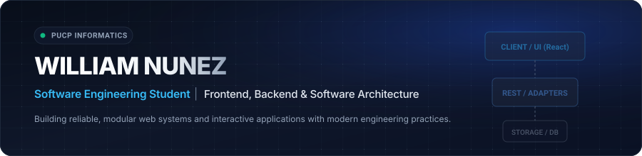

  

 

### Sobre mí

Estudiante de **Ingeniería Informática** en la **Pontificia Universidad Católica del Perú (PUCP)**. Orientado al diseño y desarrollo de soluciones de software, arquitectura de sistemas y aplicaciones web interactivas.

Experiencia práctica en desarrollo frontend con React y TypeScript, construcción de APIs RESTful con Node.js y Express, y gestión de bases de datos relacionales (PostgreSQL, MySQL y SQL Server).

  

---

### Proyectos Destacados

<table>
  <tr>
    <td width="50%" valign="top">
      <h3 align="left">FindRoom — Plataforma de Alojamiento Estudiantil</h3>
      

        Plataforma web para conectar a estudiantes de la PUCP con arrendadores verificados (SUNARP / RENIEC). Implementa arquitectura dual-mode (API REST / Local Storage reactivo con Adapter Pattern), buscador paramétrico en tiempo real, estimación de distancias al campus, protección de canales de contacto directo y sistema bilateral de evaluaciones.
      

      

        <b>Tecnologías:</b> React 19, TypeScript, Vite, Tailwind CSS, Node.js, Express, PostgreSQL, Prisma. 
        <b>Enlace en producción:</b> <a href="https://findroom-pucp.netlify.app/">findroom-pucp.netlify.app</a> 
        <b>Repositorio:</b> <a href="https://github.com/liw404/findroom-pucp">github.com/liw404/findroom-pucp</a>
      

    </td>
    <td width="50%" valign="top">
      <h3 align="left">Calculadora de Notas Acumuladas</h3>
      

        Single Page Application responsive orientada al cálculo, simulación y proyección de promedios académicos en escala vigesimal. Cuenta con esquemas de ponderación dinámica, agrupación por categorías de evaluación, sincronización de estado y persistencia mediante Web Storage API con importación/exportación JSON.
      

      

        <b>Tecnologías:</b> React, Vite, JavaScript, CSS3, Web Storage API. 
        <b>Enlace en producción:</b> <a href="https://notas-app-liw.netlify.app/">notas-app-liw.netlify.app</a>
      

    </td>
  </tr>
</table>

---

### Stack Tecnológico

#### Lenguajes de Programación

  
  
  
  
  
  

#### Desarrollo Frontend

  
  
  
  
  

#### Backend, Persistencia y Herramientas

  
  
  
  
  
  
  
  
  
  

---

### Actividad en GitHub

  
  

